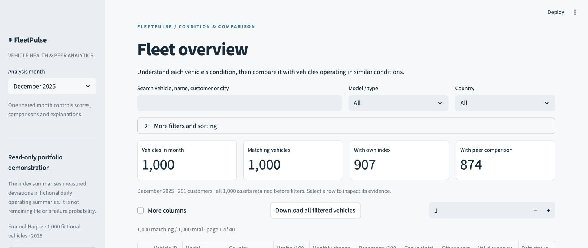
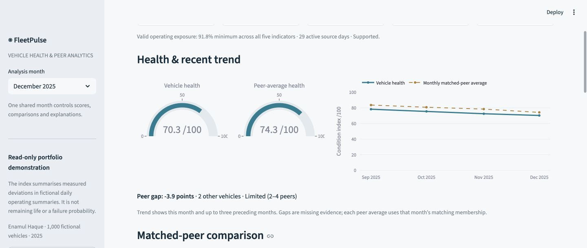
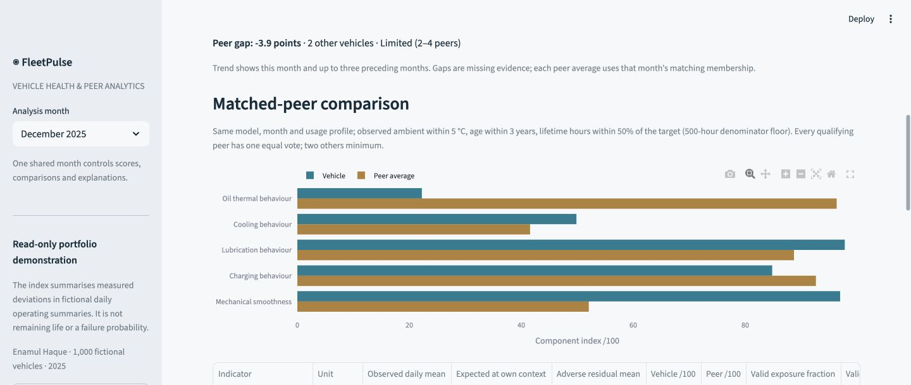
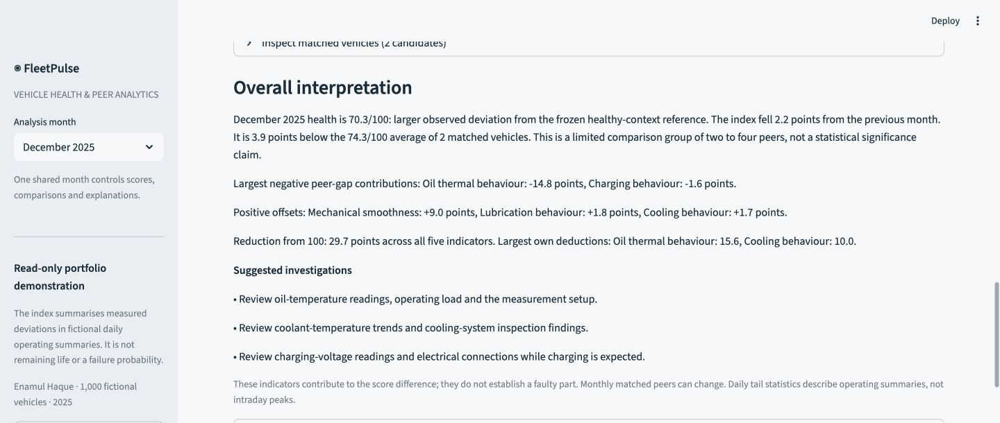

# FleetPulse — Vehicle Health & Peer Analytics

An explainable fleet-health analytics application by **Enamul Haque**. Review a vehicle’s monthly health score, compare it with similar vehicles, and identify the component-level drivers of underperformance across a synthetic fleet of **1,000 vehicles**.

**Python · Streamlit · pandas/Parquet · scikit-learn · Plotly**

- Context-adjusted healthy baselines separate operating conditions from adverse sensor behaviour.
- Transparent component contributions explain the overall score and the gap to matched peers.
- Four-month trends connect the current result with recent performance.
- Explicit coverage thresholds and sparse-peer handling keep unavailable comparisons visible.



## Use the application

1. Choose **Analysis month** (December 2025 by default). Every month starts with all 1,000 vehicles, including unavailable scores.
2. Search vehicle/name/customer/city; filter model/type, country, usage, score band/range, peer availability or a shortfall of at least five points. Sort and page through the complete result. **Download all filtered vehicles** exports all matches, not just the displayed 25 rows. Filters never change scoring or peer membership.
3. Select a native table row. Review vehicle information, **two health gauges and the four-month trend**, component comparisons and context-adjusted signals.
4. Expand peer membership, operating-exposure evidence or score arithmetic to inspect the reference and explanation. Read the proportionate suggested investigations; no part diagnosis or replacement order is generated.
5. Back restores filters/page. Changing the month changes the selected vehicle’s entire detail consistently. Early months show only available prior months; missing scores remain chart gaps.





## What the score means

The **health /100** value is a defined synthetic observational condition index. It is not remaining vehicle life, a failure probability, warranty classification or a real-world validated diagnosis. A peer mean is a relative comparison, not the healthy calibration reference.

Five equal 20% indicators: oil thermal behaviour, cooling behaviour, lubrication behaviour, charging behaviour and mechanical smoothness. A frozen healthy-context ridge reference predicts each signal from observable model, ambient, load and RPM, including defined interactions. It was fitted on a **separate known-healthy development population**, independently of the displayed fleet and its peers. Country, age, hidden condition, future observations and other degrading sensors are not predictors.

For each eligible daily operating summary:

```text
adverse residual = excess temperature/vibration, or pressure/charging deficit
severity = clip((adverse residual − healthy tolerance) /
                (severe simulation reference − healthy tolerance), 0, 1)
burden = 0.70 × exposure-weighted mean severity
       + 0.30 × exposure-weighted 95th-percentile severity
component score = 100 × (1 − burden)
health = sum(0.20 × each of five component scores)
```

Exposure is known operating hours × recorded fraction, excluding unsupported/invalid measurements. The 95th percentile is the first sorted severity whose cumulative exposure reaches 95%; it describes **daily summaries, not intraday peaks**. Tolerances use development residual median/MAD with nonzero floors. Severe references and equal weights are fictional index settings, not manufacturer service limits. No monthly min/max rescaling occurs. [Scoring/baseline card](docs/scoring-baseline-card.md).

All five indicators must have **≥80% valid operating exposure, ≥5 active days and ≥10 supported operating hours**. Otherwise overall health is null, with available components retained. Missing channels are never reweighted. Coverage is an operating denominator, not a confidence probability. Bands (90–100, 75–<90, below 75) describe smaller/larger observed deviations, not safety classes.

## Who counts as a peer

Use **all** other distinct valid vehicles in the same month/model/usage profile with observed ambient difference ≤5 °C, age difference ≤3 years and lifetime-hour difference ≤50% of `max(target lifetime hours, 500 h)`. Countries need not match. The target is excluded. At least **two others** are required; two to four is labelled limited support. No matching on score value, hidden condition or desired result; no silent widening for sparse cases.

Every eligible comparator has one equal vote, independent of operating hours. Overall and component peer means use the same members. The trend explicitly shows **monthly matched-peer average**: membership can change each month. [Peer policy](docs/peer-reference-policy.md).

Own deductions `0.20 × (100 − component)` sum to `100 − health`. Peer-gap contributions `0.20 × (own component − peer component mean)` sum to `health − peer mean`. Positive offsets are shown along with negative contributions. Previous-month component differences reconstruct change only when both complete overall scores exist. Calculations precede rounding.

## Data and measured checks

Canonical assets/usage come read-only from [FleetCare](https://github.com/Enamul22/FleetCare-PredictiveMaintenance) revision **`0f3663e31ea6610eb2a00256ca0d984ebc7c586b`**. Source IDs/counters are preserved: **1,000 vehicles, 201 customers, four models/countries, 365,000 daily usage records, 12,000 vehicle-month rows**.

Original monthly usage files do not establish a coherent year of component condition. FleetPulse therefore generates a separately identified **synthetic daily performance-history extension**, including persistent per-vehicle characteristics, independent component evolution, fictional weather variation, noise, measurement gaps and supported synthetic interventions. Hidden labels remain separate offline evaluation artifacts and are never read by the app.

December: **907 valid own scores, 874 peer comparisons, 93 unavailable overall scores**. Of valid own scores without comparison, seven have zero eligible peers and 26 have one; 121 comparisons have limited support. These counts result from the frozen rules rather than a target distribution.

Independent healthy-reference expected-signal MAE: **0.027 °C oil, 0.020 °C coolant, 0.00127 bar pressure, 0.00069 V charging, 0.00261 mm/s vibration**. All five controlled deterioration/recovery checks passed; contribution reconstruction error was below **5×10⁻¹⁴ points**. These are synthetic consistency measurements, not real-vehicle accuracy. [Validation report](docs/verification.md) records tests, noise/tail sensitivity, browser review, clean-clone and remote CI evidence.

## Run

Python **3.12** (verified 3.12.14):

```sh
python3.12 -m venv .venv
source .venv/bin/activate
python -m pip install -r requirements.lock.txt
streamlit run app.py
```

Prepared assets and frozen scoring references are bundled, so the app runs directly without a database or external API. `requirements.txt` includes the complete lock so manual Streamlit deployment uses the tested versions.

### Verify / reproduce offline

```sh
python -m pytest -q
ruff check .
ruff format --check .
PYTHONPATH=src OPENBLAS_NUM_THREADS=1 python -m fleetpulse.validate
# Regeneration alone requires a read-only source Git checkout containing the pinned object:
PYTHONPATH=src OPENBLAS_NUM_THREADS=1 python -m fleetpulse.prepare \
  --fleetcare /path/to/FleetCare-PredictiveMaintenance
```

Source/output SHA256s, seeds, policies and frozen coefficients are committed. Later score recalculation requires a new labelled score/reference revision, not silently replacing past values. [Reproducibility](docs/reproducibility.md).

[Dataset/simulator card](docs/dataset-card.md) · [Data dictionary](docs/data-dictionary.md) · [Architecture](docs/architecture.md) · [Engineering decisions](docs/progress.md)
