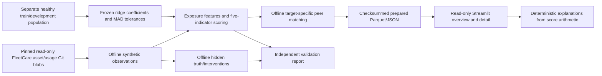

# Architecture

`app.py` loads `fleetpulse.ui`; runtime reads prepared data with `st.cache_data`, keyed by manifest fingerprint. No fit/generation, database, auth service, network inference or private absolute source path is needed. UI never reads hidden evaluation files. Month controls the same frozen row used by gauges/chart/bars/evidence/narrative. Filtering/country/search does not recompute reference membership. A complete one-row monthly grid prevents an inner join dropping unscorable vehicles.

Modules: `simulation` observation-first extension; `baseline` offline fitting and transparent observable prediction; `scoring` exposure/quality aggregation; `peers` frozen matching and exact component means; `prepare` read-only source import/bundle preparation; `validate` separate offline evaluation; `reporting` immutable filtering/pagination/detail/trend; `explanations` deterministic templates; `ui` presentation/navigation.

All joining keys are explicit. The scorer rejects duplicate vehicle/day observations and invalid operating denominators. Peer input rejects duplicate vehicle/month rows. Component/membership grains stay separate from overview, preventing row multiplication. CSV exports the complete filtered frame before pagination. Saved filter/page context is independent of temporary widget state so Back restores it; changing month resets page while maintaining a selected vehicle consistently.

Runtime reads no source project or credential. Tests/CI use included assets and independent local fixtures, with no external account/service secrets. Reference checkout/operational store/deployments are never mutated. Streamlit UI state is navigational only; the application has no operational writes to persist.
